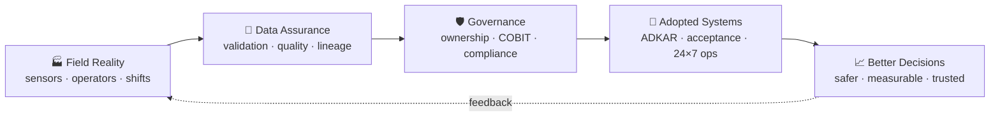

<h1 align="center">Hendro S. · HS Artifact</h1>

<p align="center">
  <i><b>artifact</b> (n.): something crafted with purpose, made to be used, built to last.<br/>
  This is my studio: where small, simple ideas become fit-for-purpose tools that grow into lasting impact.</i>
</p>

<p align="center">
  <a href="https://github.com/hs-artifact">
    
  </a>
</p>

<p align="center">
  
  
  
</p>

<p align="center">
  <a href="https://www.linkedin.com/in/hendro-sutrisno-8b4897220"></a>
  <a href="mailto:hendro.sutrisno@outlook.com"></a>
</p>

---

### ⚙️ About

Most digital programs in heavy industry don't fail on technology. They fail on **untrusted data, unclear ownership, and systems that never get accepted on site.**

That gap is where I work. Across **an international oil major, national upstream operators** and **large-scale open-pit coal mining**, I've turned operational problems into **data requirements, governance, acceptance criteria and 24×7 run models**, then driven vendors and engineering teams until the solution held up in the field.

> **Field-to-data-to-decision.** I connect operations, technology, data, governance and people, and I own the outcome, not just the deliverable.

```yaml
whoami:
  name: Hendro S.
  studio: hs-artifact
  role: [Data, Digital Transformation, Digital Operations]
  domains: [Oil & Gas, Mining, Industrial OT/IT]
  experience_years: 15+
  philosophy: "fit-for-purpose > feature-rich"
  success_metric: "adopted in the field, not just deployed"
  runs_on: 24x7, 3 shifts, every site
  open_to: [Indonesia, Malaysia, Qatar]
```



<p align="center">
  
  
  
  
  <br/>
  
  
</p>

---

### 🧭 Three Pillars

#### 📊 Data & Data Governance
*Making operational data accurate, owned and decision-ready.*
- Evidence-based **metric rules and data validation** for an operational assurance dashboard on **Databricks**
- Statistical evaluation of safety-alert data: **precision / recall / F1, TP/TN/FP/FN** validation presented to site leadership
- **Cross-system data stitching** between fleet management and telematics for a single operational view
- Brought **Weigh-In-Motion** accuracy into **compliance with the regulator's accuracy class** through loadcell calibration and data-reliability assurance, so production tonnage could be trusted for reporting
- Background in enterprise data engineering: **Oracle, PostgreSQL, SQL Server, Talend, PI Asset Framework**

#### 🚀 Digital Transformation
*Turning business need into adopted, governed digital capability.*
- **SME coordinator for 187 applications** during a major upstream block operator transition, from international to national operator
- **Requirements → acceptance → evidence** discipline for fleet, safety and production technologies
- **IT audit readiness aligned to COBIT 2019**, with clear ownership boundaries between digital and IT functions
- **Change management on the front line**, so new systems are used, not just installed:
  - **Pain-point discovery** with operators, shift crews and site leadership before any solution is chosen
  - **Stakeholder mapping (Power vs. Interest)** to decide who to manage closely, keep satisfied, keep informed or monitor
  - **ADKAR-based change strategy** (Awareness → Desire → Knowledge → Ability → Reinforcement) tailored to each stakeholder group
- **Adoption driven by trust in the data:** once WIM accuracy met the regulatory class, **WIM adoption rose from 50% to 80%**; once fatigue false alarms dropped 20%, **fatigue-alarm adoption rose from 75% to 90%**
- Product ownership practice (**PSPO I**) applied to industrial programs and vendor delivery
- Regional **CIP Gold Medal** for continuous improvement

#### 🏭 Digital Operations
*Keeping critical digital systems running, measured and improving, 24×7.*
- Led site **Digital Operations** for a large mining operation: organic team plus **24×7 managed service across 3 shifts**, sustaining **98% SLA uptime**
- Operational assurance for **fleet management on ~800 on-board units** and **collision-prevention systems across ~794 haul units**
- **Cut driver-fatigue false alarms by 20%** through data-driven threshold and hold-time tuning, improving alert credibility without weakening safety coverage
- Vendor management, field acceptance and incident-driven improvement across OT and IT boundaries

---

### 🧰 Toolbox

<p>
  
  
  
  
  
  
  
  
  
  
  
  
</p>

**Frameworks & practice:** COBIT 2019 · ADKAR Change Management · Stakeholder Mapping (Power/Interest) · Scrum / Product Ownership · Requirements & Acceptance Engineering · Vendor & Managed-Service Governance · Regulatory Compliance

**Currently sharpening:** Data Governance · PostGIS · MQTT · API integration · AI-assisted app building

---

### 🎓 Credentials

- 🏅 **Professional Scrum Product Owner I (PSPO I)** · Scrum.org
- ⛑️ **BNSP Certified: Pengawas Operasional Pertama (POP)** · Mineral & Coal Mining
- 🎓 **B.Sc. Information Systems** · STIKOM Surabaya

---

### 📂 On This Profile

#### 🏭 Featured · [FieldTrust](https://github.com/hs-artifact/fieldtrust) · [▶ Live demo](https://hs-artifact.github.io/fieldtrust/)

<a href="https://hs-artifact.github.io/fieldtrust/#value-chain"></a>

An **operational data trust platform** for oil & gas and mining: one working product across all three pillars. It maps the physical value chain (reservoir → LNG vessel, pit → shipment) to the data each stage produces, who consumes it and where trust breaks, then proves it with a contract-driven medallion pipeline, live reconciliation checks with the money at stake, 24×7 digital operations, requirement → acceptance → evidence stage gates, and adoption tracked against data trust. Synthetic data, two domain packs (gas field and open-pit mine), day and night shift modes.

[](https://github.com/hs-artifact/fieldtrust/actions/workflows/ci.yml) [](https://github.com/hs-artifact/fieldtrust/releases/latest)

`Python` · `SQL` · `pytest` · `YAML data contracts` · `JavaScript + SVG` · `GitHub Actions`

More anonymised **industrial use cases** follow across the three pillars: data quality and governance, transformation playbooks, and digital-operations tooling, each written as **problem → approach → outcome**. New ones land every few weeks. ⭐ Star or watch to follow along.

---

<p align="center">
  <i>"If it doesn't work at 3 AM on night shift, it doesn't work."</i><br/><br/>
  <b>Open to:</b> Data Governance · Digital Transformation · Digital Operations · Industrial Data<br/>
  📍 Indonesia · Malaysia · Qatar
</p>
